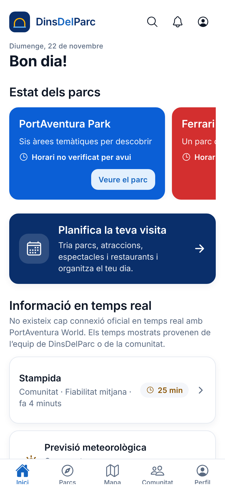
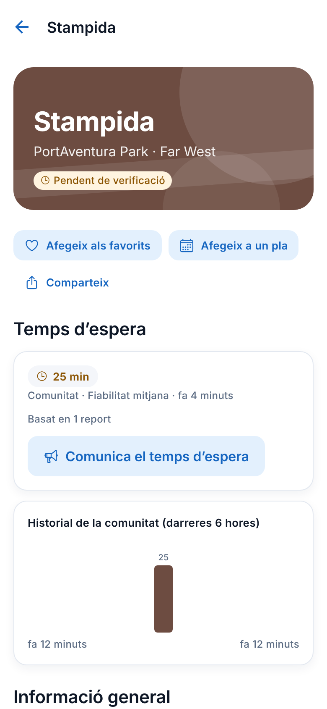
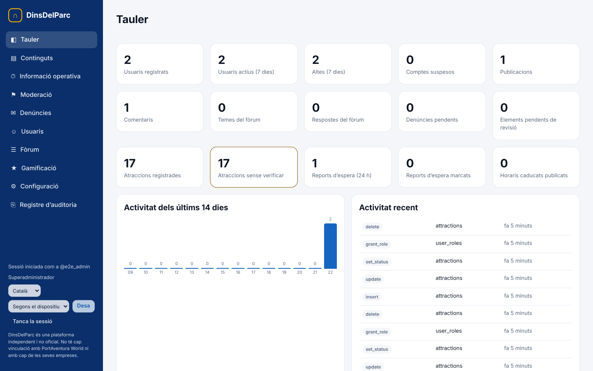

# DinsDelParc

Plataforma **independent i no oficial** per descobrir, planificar i compartir experiències als parcs de PortAventura World (PortAventura Park, Ferrari Land i Caribe Aquatic Park). No té cap vinculació amb PortAventura World.

| | |
|---|---|
|  |  |



## Contingut del monorepo

```
dinsdelparc/
├── apps/
│   ├── mobile/        Aplicació Expo (React Native, Expo Router, TypeScript) — Android, iOS i web
│   └── admin/         Panell d'administració (Next.js 16, Server Actions)
├── packages/
│   └── shared/        Lògica de negoci, validació (zod), tipus, tokens de disseny, traduccions ca/es/en
├── supabase/
│   ├── migrations/    Esquema PostgreSQL, RLS, RBAC, triggers i funcions (9 migracions)
│   ├── functions/     Edge Functions (eliminació de compte, notificacions push)
│   ├── tests/         Proves SQL (122 asserts) amb PostgreSQL local
│   └── seed.sql       Dades inicials (marcades com a pendents de verificació)
├── e2e/               Proves end-to-end Playwright contra un Supabase local
└── docs/              Arquitectura, dades, seguretat, proves, desplegament, manteniment
```

## Inici ràpid

```bash
cd dinsdelparc
npm install
npx supabase start                       # Supabase local (Docker): aplica migracions + seed
cp apps/mobile/.env.example apps/mobile/.env   # i omple-hi URL + anon key de `npx supabase status`
cp apps/admin/.env.example apps/admin/.env.local
npm run dev --workspace @dinsdelparc/admin     # http://localhost:3000
cd apps/mobile && npx expo start               # mapa natiu: cal un development build (expo run:android)
```

Per crear el primer superadministrador, consulta [docs/MAINTENANCE.md](docs/MAINTENANCE.md).

## Verificació

```bash
npm run typecheck      # shared + mobile + admin
npm test               # 59 proves unitàries
npm run test:db        # migracions + RLS + RBAC sobre PostgreSQL 16 (122 asserts)
bash e2e/run-local.sh  # E2E: Supabase local + admin + app web (5 escenaris)
```

## Documentació

- [Arquitectura](docs/ARCHITECTURE.md)
- [Política de dades i verificació](docs/DATA_POLICY.md)
- [Seguretat i RGPD](docs/SECURITY.md)
- [Proves](docs/TESTING.md)
- [Desplegament](docs/DEPLOYMENT.md)
- [Manteniment i operació](docs/MAINTENANCE.md)
